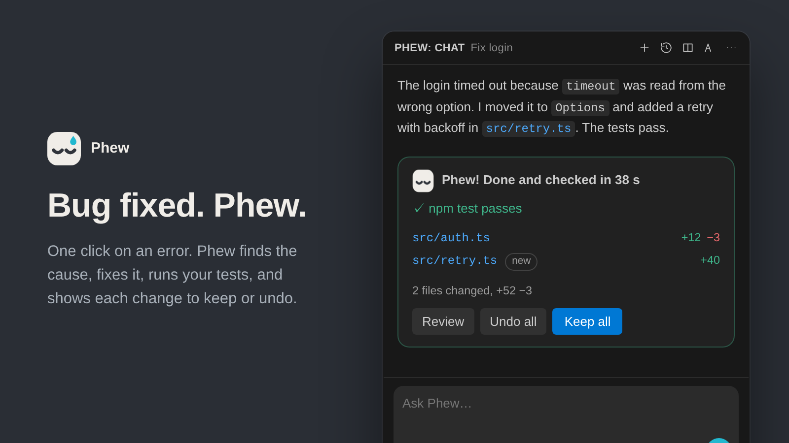
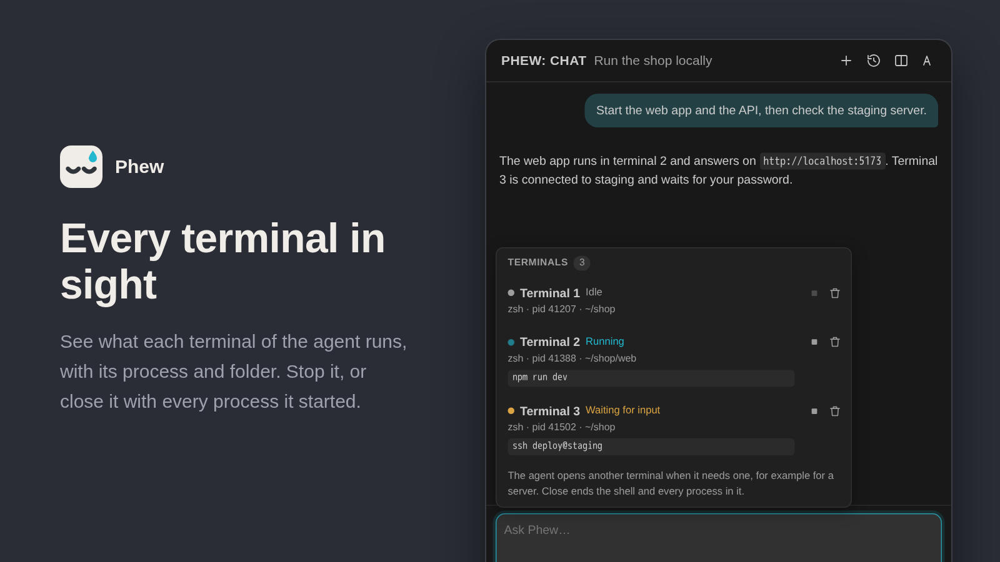
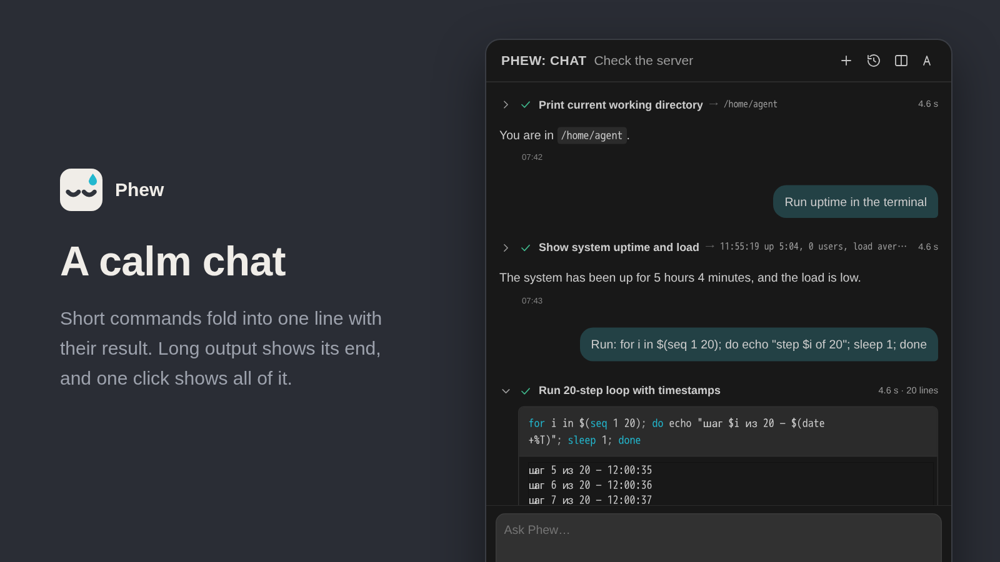
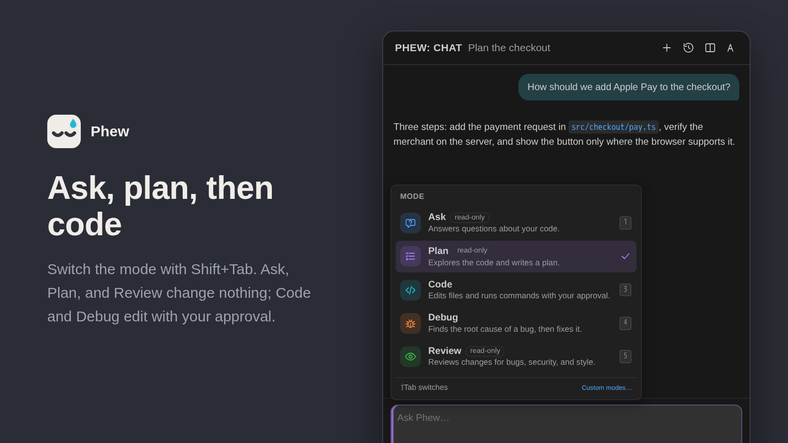
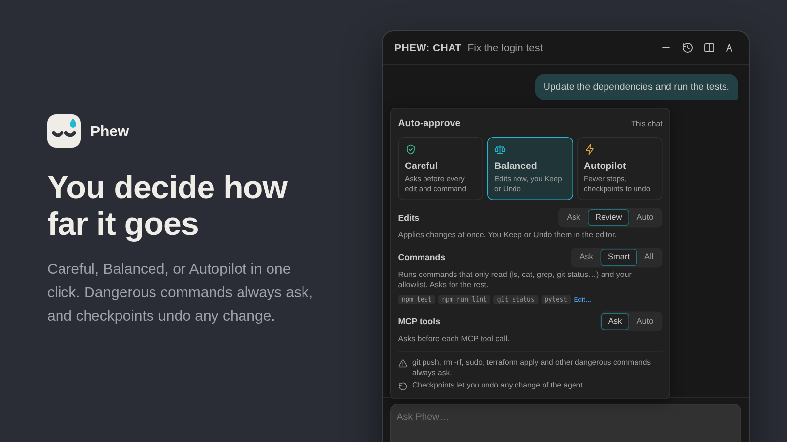
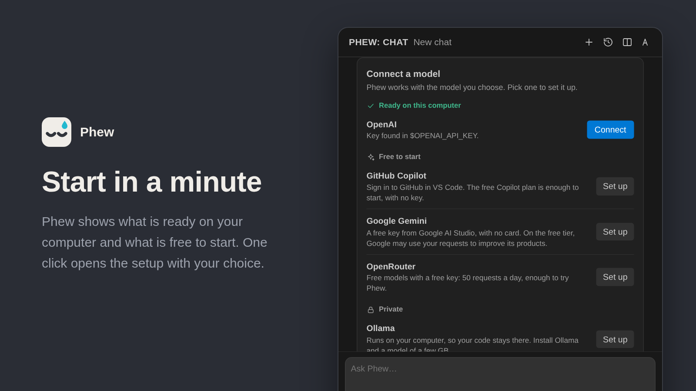

<p align="center">
  
</p>

<h1 align="center">Phew</h1>

<p align="center">
  <strong>Bug fixed. Phew.</strong><br>
  An open-source AI coding agent for VS Code that fixes errors in one click, shows every change, and works with any model.
</p>

<p align="center">
  <a href="https://marketplace.visualstudio.com/items?itemName=alekseialeinikov.phew"></a>
  <a href="https://open-vsx.org/extension/alekseialeinikov/phew"></a>
  <a href="LICENSE"></a>
</p>

<p align="center">
  
</p>

<p align="center">
  <a href="https://marketplace.visualstudio.com/items?itemName=alekseialeinikov.phew"><strong>Install from the Visual Studio Marketplace</strong></a>
  or search for <strong>Phew</strong> in the Extensions view.<br>
  On VSCodium and other editors that use Open VSX: <a href="https://open-vsx.org/extension/alekseialeinikov/phew"><strong>install from Open VSX</strong></a>.<br>
  Website: <a href="https://lf3551.github.io/phew/">lf3551.github.io/phew</a>
</p>

> [!TIP]
> Each release also has the `.vsix` file on [GitHub Releases](https://github.com/LF3551/phew/releases/latest): install it with **Extensions: Install from VSIX…**. [SECURITY.md](SECURITY.md) shows how to check that it is the real Phew.

## Why Phew

<p align="center">
  
</p>

<p align="center">
  
</p>

<p align="center">
  
</p>

<p align="center">
  
</p>

- **A real terminal, shared.** The agent works in your own shell, in a terminal of the chat: `cd`, variables, virtual environments, `ssh` into another machine, and REPLs carry over between commands. You see every command live, in the panel and in the chat, and you can type at any time: answer a prompt, press Ctrl+C, or run your own command. When a program waits for input, the agent notices and types the answer or the next command inside ssh, and it asks you for passwords; you can answer in the chat with **Your turn**, also hidden for a password. A failed command has **Phew it!**, which finds the cause and fixes it. Servers run in their own terminal, and the agent reads their log and waits until they are ready. The agent names each terminal it opens ("dev server", "tests") and closes the ones it no longer needs, a chat keeps at most six by default (`phew.commands.maxTerminals`), and idle extra terminals close themselves. Between its steps, the agent hears when a server ends or a shell closes, and when a port is taken, it learns which terminal of which chat has it. The **Terminals** button shows every terminal of the chat with its name, its process id, and its ports (click one to open it in the browser), and **All agents** shows the terminals of every chat; closing one ends all its processes, so no dev server is left behind. If a prompt theme or a startup file keeps Phew from seeing where commands end, the terminal starts again without it, and the chat says so in one line. Commands get `PHEW_AGENT=1`, so your scripts know that an agent runs them. Works with bash, zsh (also with powerlevel10k), fish, PowerShell, and sh on Linux, macOS, and Windows.
- **Phew it!** One click on an error in the editor, a failed terminal command, or failing tests. Phew finds the cause, fixes it, and checks the result.
- **Fixes until green.** Phew runs your check command, for example `npm test`, and keeps fixing until it passes.
- **Review in the editor.** Each change has **Keep** and **Undo** buttons in the file, and **Keep All** and **Undo All** in the editor title. Above the input, the files to review show with their lines added and removed, and **Keep** and **Undo** for each file. Prefer to approve first? Set **Edits** to **Ask first** in the auto-approve panel under the input.
- **Undo anything.** Each request is a checkpoint. **Restore checkpoint** reverts all file changes made after it, even after a restart.
- **Chat history.** Chats are saved per workspace, named automatically after the first answer, and grouped by day with a line from each conversation. Search finds chats by their messages, not only by their names. Pin, rename, open them in a new tab, and export them as Markdown. Delete has Undo. Every message shows its time, and every answer has a Copy button.
- **Find, fork, and edit.** Ctrl+F finds words in the chat. **Fork from here** on any of your messages starts a new chat with the conversation before it, to try another way. **Edit** takes the chat back to a message, with its files, and lets you send it again.
- **A calm chat.** A command reads as plain words with its result on the right; a short result folds into one line, and a long output shows its end with **Show all lines**. A long pasted text waits as a chip that you can open and edit. Long chats open fast.
- **Never stuck.** When the model goes quiet for 30 seconds, **Retry** sends the request again and the task goes on.
- **A mascot that shows the work.** The Phew drop blinks, looks up while it thinks, reads along a line while it reads files, and sweats while it waits for your answer. The Phew icon shows a number when a chat needs you. Choose **Lively**, **Calm**, or **Still** in **Appearance**.
- **Parallel chats.** Open a second chat in an editor tab (⧉) and let two agents work at the same time. Phew warns before two chats change the same file.
  Each chat, and each window, keeps its own model, so two keys of one provider can work side by side.
- **Subagents.** The agent can send research tasks to subagents that read and search in parallel, each with the model it needs, and report back. They only read; each has a card in the chat with its steps and its report.
- **Fallback model.** When a model runs out of quota or credit, or stays rate limited, the model you chose as its fallback goes on with the task.
- **Steer while it works.** Keep typing while the agent works: messages wait in a queue and reach the agent at its next step. `/btw` asks a quick side question without stopping the task.
- **See the thinking and the context.** Phew shows the reasoning of models that stream it, and a context meter. Long chats are compacted automatically, or with `/compact`.
- **Questions and a checklist.** The agent asks you with clickable answers when something is unclear, and keeps a checklist of the task. `/goal` sets the goal of a chat.
- **Clickable files.** `src/app.ts:42` in an answer opens the file at that line.
- **Survives rate limits.** Phew retries rate limits and server errors as long as the provider asks, and explains a missing quota or credit in plain words.
- **Rich context.** The paperclip adds the current file, the selection, the problems, the Git changes, or the last terminal output in one click, and shows what exactly it adds. Type `@` to attach any file or an earlier chat. Paste or drop screenshots. Use **Add to Chat** in the editor, the explorer, and the terminal.
- **Parallel agents.** **New Agent in Worktree** works on a new branch in a separate folder, with the model you choose for it, while you keep coding.
  The list of chats shows which agent needs you, which one failed or went quiet, and which one is done.
- **Commits your way.** Generate commit messages in the Source Control view. See the author and signing that commits use, and set Conventional Commits, `Signed-off-by`, GPG or SSH signing, a different author, and trailers. Phew never adds co-authors by itself.
- **Knows your project from the first message.** Every chat starts with a short overview that Phew gathers itself: the stack, the commands for checks, tests, lint, and build, the main folders, and the branch. `/init` writes an `AGENTS.md` from what the project shows, for you to keep or undo.
- **Rules that fit the file.** Phew reads `AGENTS.md`, `CLAUDE.md`, `GEMINI.md`, and the rule files of other agents (`.github/instructions`, `.claude/rules`, `.cursor/rules`, `.agents/rules`, `.windsurf/rules`, and `.kiro/steering`). A rule for some files comes to the agent when it reads or changes such a file; an `AGENTS.md` in a subfolder applies to that folder. Your personal rules for every project live in `~/.phew/AGENTS.md`.
- **Memory that stays true.** The agent remembers project facts in `.phew/memory.md` with the file each fact comes from, and checks a fact again when that file changed. Your preferences live in `~/.phew/memory.md` for every project. The agent corrects and forgets notes, and `/learn` saves what a chat taught after you choose.
- **Chats that know each other.** Type `@` and pick an earlier chat: the agent gets what was asked, answered, and changed there. A new chat knows about unfinished work of other sessions.
- **Code index.** Phew finds relevant code by meaning.
- **Agent Skills.** Phew uses `SKILL.md` skills from `.phew/skills`, `.agents/skills`, `.claude/skills`, and `.opencode/skills`, in the project and in your home folder, in the open Agent Skills format.
- **Several folders.** In a multi-root workspace, the agent works across all folders.
- **MCP done right.** Phew reads `.vscode/mcp.json`, `.mcp.json`, and its own settings, supports local and remote (HTTP) servers with OAuth sign-in, and lets you choose the tools of each server and read the logs (**Phew: Manage MCP Servers…**).
- **Autocomplete and Next Edit.** Inline completions and a predicted next edit, with any model.
- **Modes.** Ask, Plan, Code, Debug, Review, and your own modes, each with its color. `Shift+Tab` switches the mode.
- **Any model, one click away.** The model menu opens above the input and shows the provider and the context size of each model.
- **You decide how far it goes.** **Careful**, **Balanced**, or **Autopilot** in one click, or set edits, commands, and MCP tools one by one. By default, commands that only read (`ls`, `cat`, `grep`, `find`, `git status`, `git diff`…) run without asking, also in pipes and chains; **All** runs everything except dangerous commands; **Always allow** on a request adds a command to your allowlist.
- **Safe by default.** Phew does not read `.env` files and keys, removes secrets from tool output, and always asks before dangerous commands such as `git push --force`, `terraform apply`, or `kubectl delete`.
- **Any model.** GitHub Copilot without a key or with a GitHub token, OpenAI, Anthropic, Google Gemini, Azure OpenAI, Mistral, xAI, DeepSeek, Groq, Cerebras, Together AI, Fireworks AI, OpenRouter, LiteLLM, local models with Ollama, LM Studio, or vLLM, and company sign-in for Google Vertex AI, Azure with Entra ID, or a gateway.
- **Know the cost.** Tokens and cost per task, with optional budget limits.
- **Open source.** Apache 2.0, no telemetry.

<p align="center">
  
</p>

<p align="center">
  
</p>

## Continue anywhere

- **Handoff notes.** After each task that changes files, Phew writes a short note in `.phew/handoff/`: the goal, decisions and why, dead ends not to repeat, next steps, and how to verify. Changed files, commands, and check results come from a journal, not from the model.
- **Any agent can continue.** With your consent, Phew points `AGENTS.md` (and `CLAUDE.md` and `GEMINI.md`) to the latest note, so other coding agents pick up where Phew stopped.
- **Knows what changed.** `/continue` compares the note with the code: new commits, another branch, or files that someone changed after the note. The agent rereads those first.
- **Open format.** Plain Markdown with a small header. See [docs/HANDOFF.md](docs/HANDOFF.md).

<p align="center">
  
</p>

## Make it yours

- **Your assistant.** Give it a name, a look, and a character: Partner, Mentor, Quiet, Strict reviewer, or your own words. Tell it how to call you and which language to answer in. The dice picks a look and a name for you.
- **The Phew family.** The drop, Cat, Bot, Ghost, Sprout, Nerd, Night owl, Angel, and Ninja. Each one is the same living mascot: it blinks, follows your pointer, sweats while it works, and sighs with relief when your bug is fixed. The send button wears its symbol.
- **Your chat.** Bubbles, Classic, or Compact style, your accent color (it colors the settings page too, and always stays readable), font, text size, and a 24 or 12 hour clock: click **Aa** in the chat.
- **Phew Wrapped.** A weekly card with bugs fixed and time saved, ready to share, and achievements. All stats stay on your computer.

<p align="center">
  
</p>

<p align="center">
  
</p>

## Get started

1. Open the **Phew** view in the activity bar, or press `Ctrl+Alt+P` (`Cmd+Alt+P` on macOS).
2. The chat shows what is **ready on this computer** (GitHub Copilot in VS Code, a key in your environment such as `OPENAI_API_KEY`, or a running Ollama or LM Studio), what is **free to start**, and the **private** option. Click one: the setup opens with that provider, paste the key if it needs one, pick a model, and click **Connect and test**. Phew never downloads a model by itself.
   - **GitHub Copilot**: sign in to GitHub in VS Code; the free Copilot plan is enough to start, with no key.
     Outside VS Code, or to use the Copilot API directly, choose **GitHub Copilot (token)** with a GitHub token (also the token of the Pi coding agent): Phew finds your plan (Individual, Business, or Enterprise), or you pick it or type the address, for example for GitHub Enterprise on GHE.com.
   - **Google Gemini**: a free key from [Google AI Studio](https://aistudio.google.com/apikey), with no card. On the free tier, Google may use your requests to improve its products.
   - **OpenRouter**: free models with a free key, 50 requests a day: enough to try Phew, not for daily work.
   - **Ollama** or **LM Studio**: models on your computer, so your code stays there. Models for code take a few GB.
3. Ask a question or describe a change. Type `@` to attach context.
4. Optional: set **Checks → Verify command**, for example `npm test`, in **Phew: Open Settings**.

**Phew: Get Started** opens a short guide.

<p align="center">
  
</p>

### Company sign-in and short-lived tokens

For Google Vertex AI, Azure with Microsoft Entra ID, or a company gateway with single sign-on, give the model a command that prints the token: **Phew: Manage Models → Edit → API key from a command**, or `apiKeyCommand` in the profile:

```jsonc
{
  "id": "vertex",
  "name": "Gemini on Vertex AI",
  "provider": "openai",
  "baseUrl": "https://aiplatform.googleapis.com/v1/projects/MY-PROJECT/locations/global/endpoints/openapi",
  "model": "google/gemini-3.8-flash",
  "apiKeyCommand": "gcloud auth print-access-token"
}
```

Phew runs the command in your home folder, keeps the token in memory, runs it again before the token expires (the command may print JSON with `expires_in` or `expires_on`, like `az account get-access-token`) and when the server answers 401, and never logs the token. Only your user settings can set the command, not a workspace.

## Modes

| Mode | What Phew does |
| --- | --- |
| **Ask** | Answers questions. Changes nothing. |
| **Plan** | Explores the code and writes a plan. Changes nothing. |
| **Code** | Edits files and runs commands with your approval. |
| **Debug** | Reproduces the problem, finds the root cause, and fixes it. |
| **Review** | Reviews the current changes. Changes nothing. |
| Custom | Your own instructions, tools, and model, from the settings or `.phew/modes.json`. |

Ask, Plan, and Review are read-only: the mode switch shows a lock for them.

## Keyboard shortcuts

| Shortcut | Action |
| --- | --- |
| `Ctrl+Alt+P` | Open the chat |
| `Ctrl+Alt+Shift+P` | Open a parallel chat in an editor tab |
| `Ctrl+Alt+L` | Add the selection or the file to the chat |
| `Ctrl+Alt+.` | Phew it! Fix the problem at the cursor |
| `Alt+]` | Suggest the next edit |
| `Ctrl+Alt+Y` / `Ctrl+Alt+Z` | Keep or undo all changes in the file |
| `↑` in an empty input | Reuse an earlier request |
| `Shift+Tab` in the input | Switch the mode |
| `/btw`, `/goal`, `/compact` | Side question, goal of the chat, compact the chat |
| `/init`, `/learn` | Write AGENTS.md for this project; save what this chat taught |
| `Ctrl+F` in the chat | Find in the chat |

On macOS, use `Cmd` instead of `Ctrl`.

In the terminal of a command in the chat:

| Shortcut | Action |
| --- | --- |
| `Ctrl+C` (also on macOS) | Copy the selected text, or stop the command when nothing is selected |
| `Ctrl+D` | End the input of the command |
| `Ctrl+F` (`Cmd+F` on macOS) | Find in the output |
| Typing and `Enter` | Answer a prompt of the command |

## Settings

**Phew: Open Settings** opens a settings page with a search field and a menu in five groups: **Models** (your models, the connection, autocomplete, and the code index), **Agent** (the agent, your assistant, memory, modes, and skills, and handoff notes), **Safety** (approvals, checks, budget, and privacy), **Git and tools** (commits, worktrees, and MCP), and **Look and feel**.
Each model shows its provider, its context size, and whether its key is saved, with **Use**, **Test**, and **Key** at hand.
The approval toggles in the chat change only that chat; **save as default** makes them the default.
Notifications, the sound, the font size of the chat, and the send key (`Enter` or `Ctrl+Enter`) are in **Agent**.
`phew.commands.terminal` chooses whether the terminal of the chat opens in the panel with the first command, only on request, or never (then each command runs in a hidden process). `phew.commands.shell` sets its shell, and `phew.commands.shellStartupFiles` turns your startup files off for a fast, plain shell.
`phew.commands.approval` (**Ask**, **Smart**, or **All**), `phew.commands.autoApprove`, and `phew.commands.deny` decide which commands run without asking.
Every setting is also available in the VS Code settings under **Phew**.

## Security and privacy

- Phew sends your prompts, the files that the agent reads, and tool output to the model provider that you choose.
  Use a local model if your code must not leave your computer.
- In Restricted Mode, Phew only answers questions.
  It does not change files, run commands, start MCP servers, or read the rules, memory, or modes of the project; your personal rules and memory in `~/.phew` still apply.
- Model profiles come only from the user settings, so a workspace cannot send your API keys to another server or set a key command.
- Commands that change something ask first in the default **Smart** mode; dangerous commands such as `git push`, `rm -rf`, `sudo`, or `terraform apply` always ask, and `phew.commands.deny` blocks commands for good.
- The agent's terminal is yours: you see every command, and passwords go from you to the program, never to the model.
  Closing a terminal or a chat ends every process that it started.
- Every tool call is written to the **Phew** output channel (`Phew: Show Log`).
- Phew collects no telemetry. Statistics stay on your computer.
- Each release is built by the Release workflow of this repository and comes with a SHA-256 checksum and, from 0.5.0, a signed build provenance attestation. [SECURITY.md](SECURITY.md) shows how to check that you have the real Phew.

See [SECURITY.md](SECURITY.md) to report a vulnerability.

## Development

Requirements: Node.js 22 or newer.

```sh
npm ci
npm run check            # type check, lint, and unit tests
npm run build            # build dist/ with esbuild
npm run test:integration # run the extension in VS Code with a fake model server
npm run package          # create phew.vsix
npm run images           # render the README pictures from the real chat (needs Playwright)
npm run site             # build the website into _site/ (open _site/index.html)
npm run ui:audit         # check the chat in 3 themes and 3 widths: overflow, names, contrast (needs Playwright)
```

Press `F5` in VS Code to start an Extension Development Host.
The architecture is described in [docs/ARCHITECTURE.md](docs/ARCHITECTURE.md).
The website lives in `site/` and uses the pictures in `docs/images`; the **Website** workflow publishes it to GitHub Pages after each change on `main`.

## Releasing

See [docs/RELEASING.md](docs/RELEASING.md).

## Like Phew?

A rating helps other developers find it: [rate Phew on the Visual Studio Marketplace](https://marketplace.visualstudio.com/items?itemName=alekseialeinikov.phew&ssr=false#review-details) or [on Open VSX](https://open-vsx.org/extension/alekseialeinikov/phew/reviews), or star the repository. Ideas and problems are welcome as [issues](https://github.com/LF3551/phew/issues).

Found a problem? Run **Phew: Report a Problem…** (also in the **⋯** menu of the chat). Phew writes a report with the versions, the system, the shell, the model, safe settings, and the recent log, without secrets, your user name, your home folder, or the folders of your project. You read it in the editor first, and only then it opens the bug form on GitHub, filled in.

Phew asks for a rating itself only rarely: a small card under a task that went well, after 5 tasks on 3 different days, at most once a month and three times in total, and never again after you rate it or choose **Don't ask again** (`phew.ui.askForRating`). **Phew: Rate Phew** opens the store at any time.

## Contributing

Contributions are welcome.
Read [CONTRIBUTING.md](CONTRIBUTING.md) before you open a pull request.

## License

Phew is licensed under the [Apache License 2.0](LICENSE).
Copyright 2026 [Aleksei Aleinikov](https://www.alekseialeinikov.com).

If you redistribute Phew or a work based on it, you must keep the [LICENSE](LICENSE) and [NOTICE](NOTICE) files, which credit the author.
"Phew" and the Phew logo are trademarks of Aleksei Aleinikov; see [TRADEMARKS.md](TRADEMARKS.md).
"Visual Studio Code" is a trademark of Microsoft Corporation.
