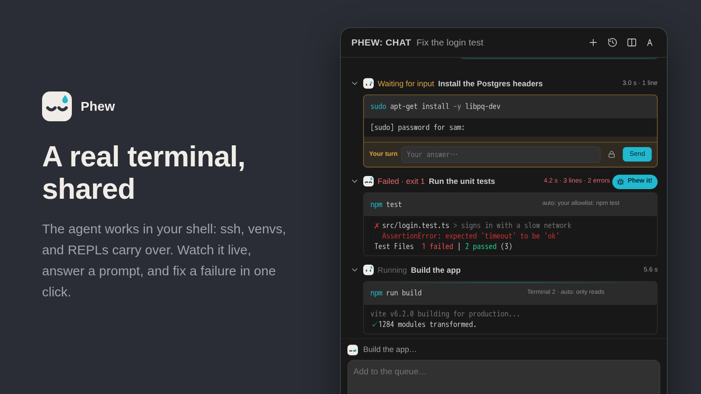
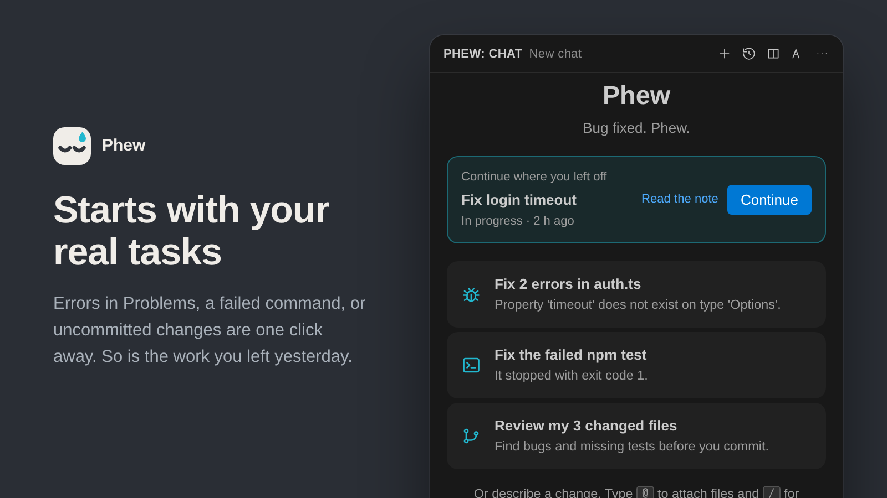
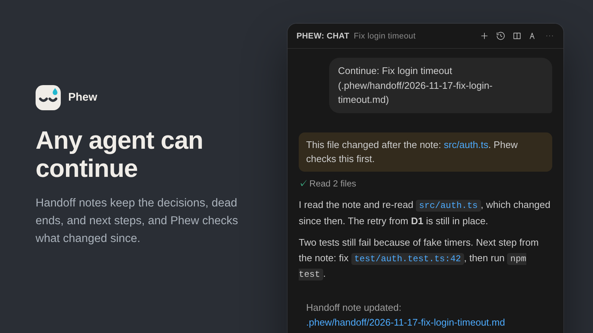
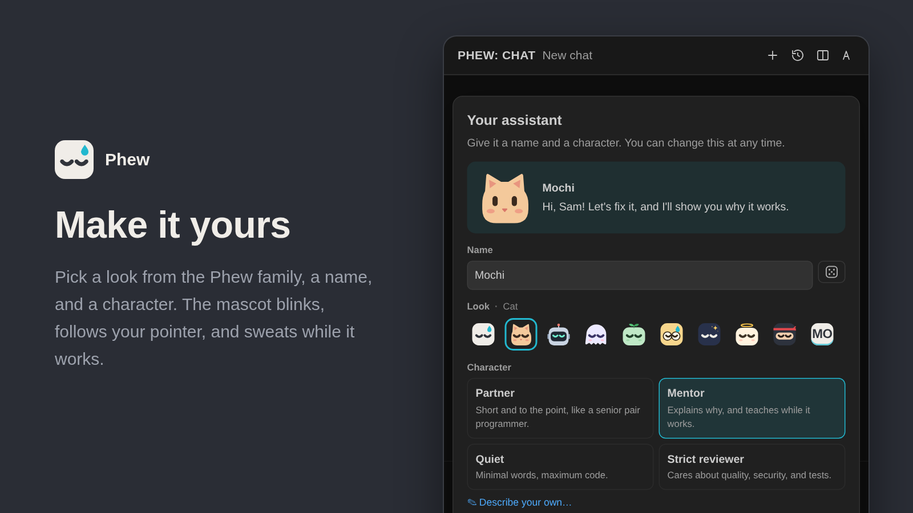
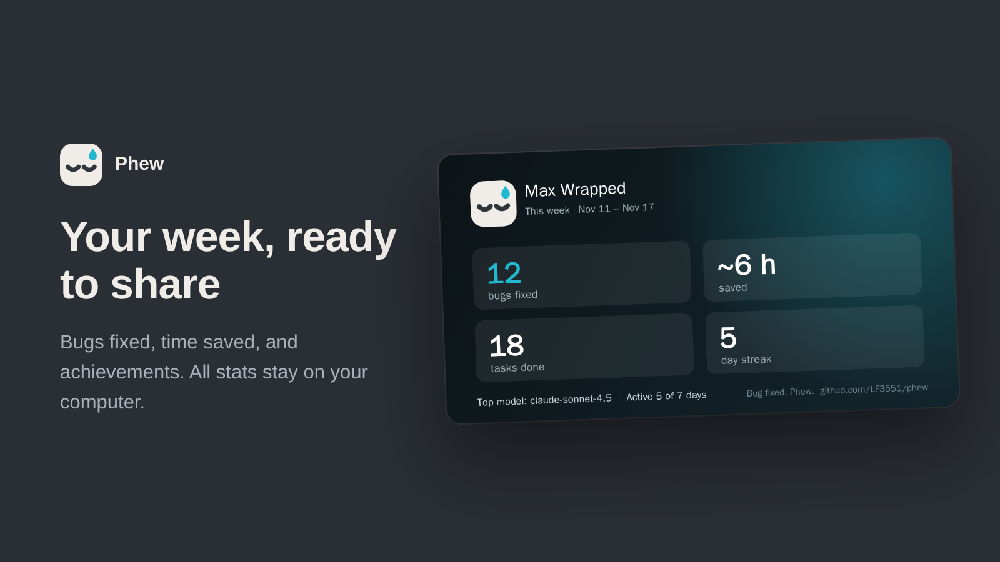

<p align="center">
  
</p>

<h1 align="center">Phew</h1>

<p align="center">
  <strong>Bug fixed. Phew.</strong><br>
  An open-source AI coding agent for VS Code that fixes errors in one click, shows every change, and works with any model.
</p>

<p align="center">
  <a href="LICENSE"></a>
  
</p>

<p align="center">
  
</p>

<p align="center">
  <a href="https://marketplace.visualstudio.com/items?itemName=alekseialeinikov.phew"><strong>Install from the Visual Studio Marketplace</strong></a>
  or search for <strong>Phew</strong> in the Extensions view.
</p>

> [!NOTE]
> Phew is in preview. Each release also has the `.vsix` file on [GitHub Releases](https://github.com/LF3551/phew/releases/latest).

## Why Phew

<p align="center">
  
</p>

<p align="center">
  
</p>

- **A real terminal, shared.** The agent works in your own shell, in a terminal of the chat: `cd`, variables, virtual environments, `ssh` into another machine, and REPLs carry over between commands. You see every command live, in the panel and in the chat, and you can type at any time: answer a prompt, press Ctrl+C, or run your own command. When a program waits for input, the agent notices and types the answer or the next command inside ssh, and it asks you for passwords; you can answer in the chat with **Your turn**, also hidden for a password. A failed command has **Phew it!**, which finds the cause and fixes it. Servers run in their own terminal, and the agent reads their log and waits until they are ready. The **Terminals** button shows every terminal of the chat with its process id; closing one ends all its processes, so no dev server is left behind. Commands get `PHEW_AGENT=1`, so your scripts know that an agent runs them. Works with bash, zsh (also with powerlevel10k), fish, PowerShell, and sh on Linux, macOS, and Windows.
- **Phew it!** One click on an error in the editor, a failed terminal command, or failing tests. Phew finds the cause, fixes it, and checks the result.
- **Fixes until green.** Phew runs your check command, for example `npm test`, and keeps fixing until it passes.
- **Review in the editor.** Each change has **Keep** and **Undo** buttons in the file, and **Keep All** and **Undo All** in the editor title. Prefer to approve first? Switch **Edits** to **Ask first** in the chat.
- **Undo anything.** Each request is a checkpoint. **Restore checkpoint** reverts all file changes made after it, even after a restart.
- **Chat history.** Chats are saved per workspace, named automatically after the first answer, and grouped by day with a line from each conversation. Pin, search, rename, open them in a new tab, and export them as Markdown. Delete has Undo. Every message shows its time, and every answer has a Copy button.
- **A mascot that shows the work.** The Phew drop blinks, looks up while it thinks, reads along a line while it reads files, and sweats while it waits for your answer. The Phew icon shows a number when a chat needs you. Choose **Lively**, **Calm**, or **Still** in **Appearance**.
- **Parallel chats.** Open a second chat in an editor tab (⧉) and let two agents work at the same time. Phew warns before two chats change the same file.
- **Steer while it works.** Keep typing while the agent works: messages wait in a queue and reach the agent at its next step. `/btw` asks a quick side question without stopping the task.
- **See the thinking and the context.** Phew shows the reasoning of models that stream it, and a context meter. Long chats are compacted automatically, or with `/compact`.
- **Questions and a checklist.** The agent asks you with clickable answers when something is unclear, and keeps a checklist of the task. `/goal` sets the goal of a chat.
- **Clickable files.** `src/app.ts:42` in an answer opens the file at that line.
- **Survives rate limits.** Phew retries rate limits and server errors as long as the provider asks, and explains a missing quota or credit in plain words.
- **Rich context.** The paperclip adds the current file, the selection, the problems, the Git changes, or the last terminal output in one click, and shows what exactly it adds. Type `@` to attach any file. Paste or drop screenshots. Use **Add to Chat** in the editor, the explorer, and the terminal.
- **Parallel agents.** **New Agent in Worktree** works on a new branch in a separate folder while you keep coding.
- **Commits your way.** Generate commit messages in the Source Control view. See the author and signing that commits use, and set Conventional Commits, `Signed-off-by`, GPG or SSH signing, a different author, and trailers. Phew never adds co-authors by itself.
- **Code index and memory.** Phew finds relevant code by meaning and remembers durable project facts in `.phew/memory.md`.
- **Agent Skills.** Phew uses `SKILL.md` skills from `.phew/skills`, `.agents/skills`, `.claude/skills`, and `.opencode/skills`, in the project and in your home folder, the same format as Claude Code.
- **Several folders.** In a multi-root workspace, the agent works across all folders.
- **MCP done right.** Phew reads `.vscode/mcp.json`, `.mcp.json` (Claude Code), and its own settings, supports local and remote (HTTP) servers with OAuth sign-in, and lets you choose the tools of each server and read the logs (**Phew: Manage MCP Servers…**).
- **Autocomplete and Next Edit.** Inline completions and a predicted next edit, with any model.
- **Modes.** Ask, Plan, Code, Debug, Review, and your own modes, each with its color. `Shift+Tab` switches the mode.
- **Any model, one click away.** The model menu opens above the input and shows the provider and the context size of each model.
- **You decide how far it goes.** **Careful**, **Balanced**, or **Autopilot** in one click, or set edits, commands, and MCP tools one by one. By default, commands that only read (`ls`, `cat`, `grep`, `find`, `git status`, `git diff`…) run without asking, also in pipes and chains; **All** runs everything except dangerous commands; **Always allow** on a request adds a command to your allowlist.
- **Safe by default.** Phew does not read `.env` files and keys, removes secrets from tool output, and always asks before dangerous commands such as `git push --force`, `terraform apply`, or `kubectl delete`.
- **Any model.** GitHub Copilot without a key or with a GitHub token, OpenAI, Anthropic, Google Gemini, Azure OpenAI, Mistral, xAI, DeepSeek, Groq, Cerebras, Together AI, Fireworks AI, OpenRouter, LiteLLM, and local models with Ollama, LM Studio, or vLLM.
- **Know the cost.** Tokens and cost per task, with optional budget limits.
- **Open source.** Apache 2.0, no telemetry.

<p align="center">
  
</p>

<p align="center">
  
</p>

## Continue anywhere

- **Handoff notes.** After each task that changes files, Phew writes a short note in `.phew/handoff/`: the goal, decisions and why, dead ends not to repeat, next steps, and how to verify. Changed files, commands, and check results come from a journal, not from the model.
- **Any agent can continue.** With your consent, Phew points `AGENTS.md` (and `CLAUDE.md` and `GEMINI.md`) to the latest note, so Codex, Copilot, Cursor, Claude Code, and others pick up where Phew stopped.
- **Knows what changed.** `/continue` compares the note with the code: new commits, another branch, or files that someone changed after the note. The agent rereads those first.
- **Open format.** Plain Markdown with a small header. See [docs/HANDOFF.md](docs/HANDOFF.md).

<p align="center">
  
</p>

## Make it yours

- **Your assistant.** Give it a name, a look, and a character: Partner, Mentor, Quiet, Strict reviewer, or your own words. Tell it how to call you and which language to answer in. The dice picks a look and a name for you.
- **The Phew family.** The drop, Cat, Bot, Ghost, Sprout, Nerd, Night owl, Angel, and Ninja. Each one is the same living mascot: it blinks, follows your pointer, sweats while it works, and sighs with relief when your bug is fixed. The send button wears its symbol.
- **Your chat.** Bubbles, Classic, or Compact style, your accent color, font, and text size: click **Aa** in the chat.
- **Phew Wrapped.** A weekly card with bugs fixed and time saved, ready to share, and achievements. All stats stay on your computer.

<p align="center">
  
</p>

<p align="center">
  
</p>

## Get started

1. Open the **Phew** view in the activity bar, or press `Ctrl+Alt+P` (`Cmd+Alt+P` on macOS).
2. Choose **Connect a model**. Click a provider, paste the key (or use the key from your environment), click **Load models**, pick a model, and click **Connect and test**.
3. Ask a question or describe a change. Type `@` to attach context.
4. Optional: set **Checks → Verify command**, for example `npm test`, in **Phew: Open Settings**.

**Phew: Get Started** opens a short guide.

## Modes

| Mode | What Phew does |
| --- | --- |
| **Ask** | Answers questions. Changes nothing. |
| **Plan** | Explores the code and writes a plan. Changes nothing. |
| **Code** | Edits files and runs commands with your approval. |
| **Debug** | Reproduces the problem, finds the root cause, and fixes it. |
| **Review** | Reviews the current changes. Changes nothing. |
| Custom | Your own instructions, tools, and model, from the settings or `.phew/modes.json`. |

Ask, Plan, and Review are read-only: the mode switch shows a lock for them.

## Keyboard shortcuts

| Shortcut | Action |
| --- | --- |
| `Ctrl+Alt+P` | Open the chat |
| `Ctrl+Alt+Shift+P` | Open a parallel chat in an editor tab |
| `Ctrl+Alt+L` | Add the selection or the file to the chat |
| `Ctrl+Alt+.` | Phew it! Fix the problem at the cursor |
| `Alt+]` | Suggest the next edit |
| `Ctrl+Alt+Y` / `Ctrl+Alt+Z` | Keep or undo all changes in the file |
| `↑` in the input | Reuse an earlier request |
| `Shift+Tab` in the input | Switch the mode |
| `Ctrl+C` in a command terminal | Stop the command (typing answers its prompt) |
| `/btw`, `/goal`, `/compact` | Side question, goal of the chat, compact the chat |

On macOS, use `Cmd` instead of `Ctrl`.

## Settings

**Phew: Open Settings** opens a settings page with sections for models, the agent, approvals, checks, budget, commits, worktrees, the code index, autocomplete, memory, modes, and skills, MCP, privacy, and the interface.
The approval toggles in the chat change only that chat; **save as default** makes them the default.
Notifications, the sound, the font size of the chat, and the send key (`Enter` or `Ctrl+Enter`) are in **Agent**.
`phew.commands.terminal` chooses whether the terminal of the chat opens in the panel with the first command, only on request, or never (then each command runs in a hidden process). `phew.commands.shell` sets its shell.
Every setting is also available in the VS Code settings under **Phew**.

## Security and privacy

- Phew sends your prompts, the files that the agent reads, and tool output to the model provider that you choose.
  Use a local model if your code must not leave your computer.
- In Restricted Mode, Phew only answers questions.
  It does not change files, run commands, start MCP servers, or read project rules, memory, or modes.
- Model profiles come only from the user settings, so a workspace cannot send your API keys to another server.
- Every tool call is written to the **Phew** output channel (`Phew: Show Log`).
- Phew collects no telemetry. Statistics stay on your computer.

See [SECURITY.md](SECURITY.md) to report a vulnerability.

## Development

Requirements: Node.js 22 or newer.

```sh
npm ci
npm run check            # type check, lint, and unit tests
npm run build            # build dist/ with esbuild
npm run test:integration # run the extension in VS Code with a fake model server
npm run package          # create phew.vsix
npm run images           # render the README pictures from the real chat (needs Playwright)
```

Press `F5` in VS Code to start an Extension Development Host.
The architecture is described in [docs/ARCHITECTURE.md](docs/ARCHITECTURE.md).

## Releasing

See [docs/RELEASING.md](docs/RELEASING.md).

## Contributing

Contributions are welcome.
Read [CONTRIBUTING.md](CONTRIBUTING.md) before you open a pull request.

## License

Phew is licensed under the [Apache License 2.0](LICENSE).
Copyright 2026 [Aleksei Aleinikov](https://www.alekseialeinikov.com).

If you redistribute Phew or a work based on it, you must keep the [LICENSE](LICENSE) and [NOTICE](NOTICE) files, which credit the author.
"Phew" and the Phew logo are trademarks of Aleksei Aleinikov; see [TRADEMARKS.md](TRADEMARKS.md).
"Visual Studio Code" is a trademark of Microsoft Corporation.
