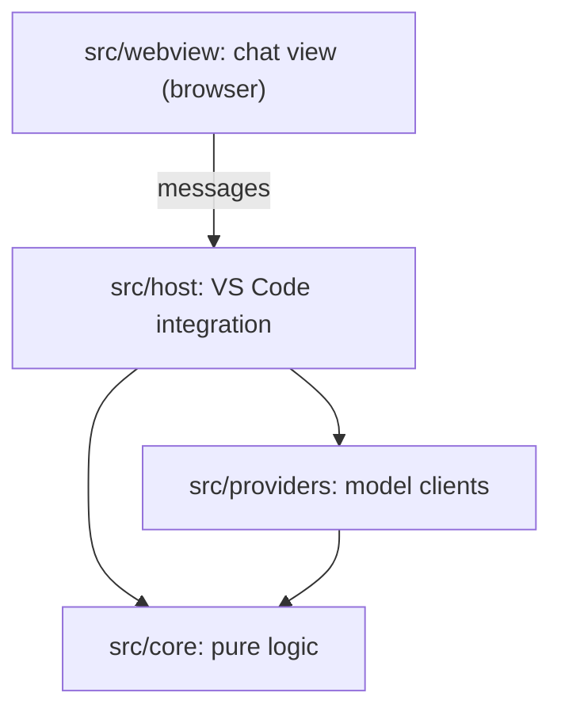

# Architecture

Phew has three layers.
Each layer depends only on the layers below it.

## `src/core`

Pure TypeScript without the `vscode` module, so unit tests run in Node.js.

| File | Purpose |
| --- | --- |
| `agent.ts` | The agent loop: model call, tool calls, step and budget limits, the check loop that fixes until green, and reminders to apply fixes. |
| `attachments.ts` | Attachments, `@` mentions, and the context format. |
| `codeIndex.ts` | BM25 code index with identifier-aware tokens and optional embeddings. |
| `commit.ts` | Commit message prompts, trailers, identity, signing, and flags for agent commits. |
| `completion.ts` | Inline completion and next edit prompts and parsing. |
| `export.ts` | Markdown export and chat titles. |
| `memory.ts` | Project memory notes. |
| `review.ts` | Keep and undo of single hunks for the review in the editor. |
| `worktree.ts` | Branch names, worktree folders, and `git worktree list` parsing. |
| `compaction.ts` | Context estimates and the summary of older messages. |
| `journal.ts`, `handoff.ts` | The session journal (facts) and handoff notes: the request to the model, rendering, freshness checks, and the `AGENTS.md` section. See [HANDOFF.md](HANDOFF.md). |
| `persona.ts`, `achievements.ts`, `appearance.ts` | The assistant persona, local achievements and Wrapped, and the chat appearance. |
| `skills.ts` | `SKILL.md` parsing and the skills prompt. |
| `plan.ts` | The checklist and the questions of the agent. |
| `roots.ts` | Paths across the folders of a multi-root workspace. |
| `mcpConfig.ts`, `mcpHttp.ts`, `oauth.ts` | MCP configuration files and variables, the Streamable HTTP transport, and OAuth with PKCE. |
| `chat.ts` | Message types, argument parsing, and history trimming. |
| `tools.ts` | Tool definitions in JSON Schema and the tools of each mode. |
| `modes.ts` | Built-in and custom modes and their tool groups. |
| `prompts.ts` | The system prompt and the requests of the "Phew it!" workflows. |
| `diff.ts` | Line diff (Myers algorithm), hunks, and partial apply. |
| `checkpoints.ts` | Original file content per request and restore planning. |
| `commandPolicy.ts` | Dangerous command detection and auto-approve and deny lists. |
| `secrets.ts` | Sensitive file detection and secret redaction. |
| `cost.ts` | Token and cost tracking and budget limits. |
| `rules.ts` | Project rule files and their combination. |
| `mcp.ts` | Minimal Model Context Protocol client over newline-delimited JSON-RPC. |
| `sse.ts` | Server-Sent Events parser for streamed model responses. |
| `stats.ts` | Local statistics. |
| `paths.ts` | Workspace path containment. |

## `src/providers`

`openaiCompatible.ts` streams chat completions with tool calls from any OpenAI-compatible API.
`presets.ts` lists common providers and validates base URLs.

## `src/host`

| File | Purpose |
| --- | --- |
| `sessionManager.ts` | All chats of the window, the views that show them, the saved history, file claims between parallel chats, notifications, and worktree agents. |
| `chatView.ts` | One controller per webview: the side bar follows the active chat, and editor tabs show one pinned chat each. |
| `skillStore.ts` | Finds and reads Agent Skills. |
| `session.ts` | One conversation: the queue, `/btw`, compaction, reasoning, approvals of the chat, the plan, the transcript, checkpoints, and persistence. |
| `conversationStore.ts` | Saved chats in the workspace storage. |
| `reviewManager.ts` | Keep and Undo CodeLens and decorations in the editor. |
| `codeIndexManager.ts` | Builds, updates, saves, and searches the code index. |
| `commitAssistant.ts`, `git.ts` | Commit messages, commits, Git identity, and Git commands without a shell. |
| `completions.ts` | Inline completions and next edit prediction. |
| `memoryStore.ts`, `attachments.ts` | Project memory and attachment resolution with the `@` menu. |
| `handoffs.ts` | Writes journals and notes in `.phew/`, keeps `.phew/.gitignore`, reads Git state and file fingerprints, and asks before it changes `AGENTS.md`. |
| `models.ts`, `vscodeLmClient.ts` | Model profiles, setup, tests, and VS Code language models. |
| `settingsPanel.ts` | The settings page, generated from the configuration schema. |
| `toolHost.ts` | Executes tools inside the workspace with path, secret, trust, and command checks. |
| `changes.ts` | Shows changes as hunks, applies the selected hunks, records checkpoints, and serves the diff editor. |
| `approvals.ts` | Sends approval requests to the view and waits for the decision. |
| `commandRunner.ts` | Runs shell commands with a timeout, an output limit, and cancellation. Keeps the folder and the exported variables of a chat between commands, and passes typed input to the command. |
| `agentTerminal.ts` | The terminal of a chat in the panel (a pseudoterminal). It mirrors the output of the agent's commands in color, and its keys go to the running command. |
| `mcpManager.ts` | Reads MCP configurations, connects stdio and HTTP servers, signs in with OAuth, filters tools, and logs. |
| `phewIt.ts` | The "Phew it!" quick fix on problems. |
| `terminalWatcher.ts` | Remembers failed terminal commands through shell integration. |
| `chatView.ts` | The webview view provider and the transcript that rebuilds a hidden view. |
| `providerSetup.ts` | Provider, model, and API key setup. The key goes to SecretStorage. |
| `rulesLoader.ts`, `settings.ts`, `statsStore.ts`, `html.ts` | Rules, settings, statistics, and the webview document. |

## `src/webview`

The chat view runs in a sandboxed webview with a strict Content Security Policy and a script nonce.
`markdown.ts` builds DOM nodes from a safe Markdown subset and never parses HTML.
`src/shared/protocol.ts` defines the messages between the view and the host, and the host validates every message.
`terminalBlock.ts` shows each command in a terminal inside the chat (xterm.js), like the Copilot agent: the same live output as the terminal in the panel, and keys go to the command through `core/lineEditor.ts`.
xterm.js adds `<style>` elements; they get the nonce of the page, so the policy needs no `unsafe-inline`.
The menus under the input are separate modules: `modeMenu.ts`, `modelMenu.ts`, `attachMenu.ts`, and `approvalsPanel.ts`.

## Tests

- `test/*.test.ts`: unit tests with Vitest.
- `test/integration`: starts VS Code with the extension and a fake model server, fixes a file, runs the check, restores the checkpoint, and checks the "Phew it!" quick fix.
