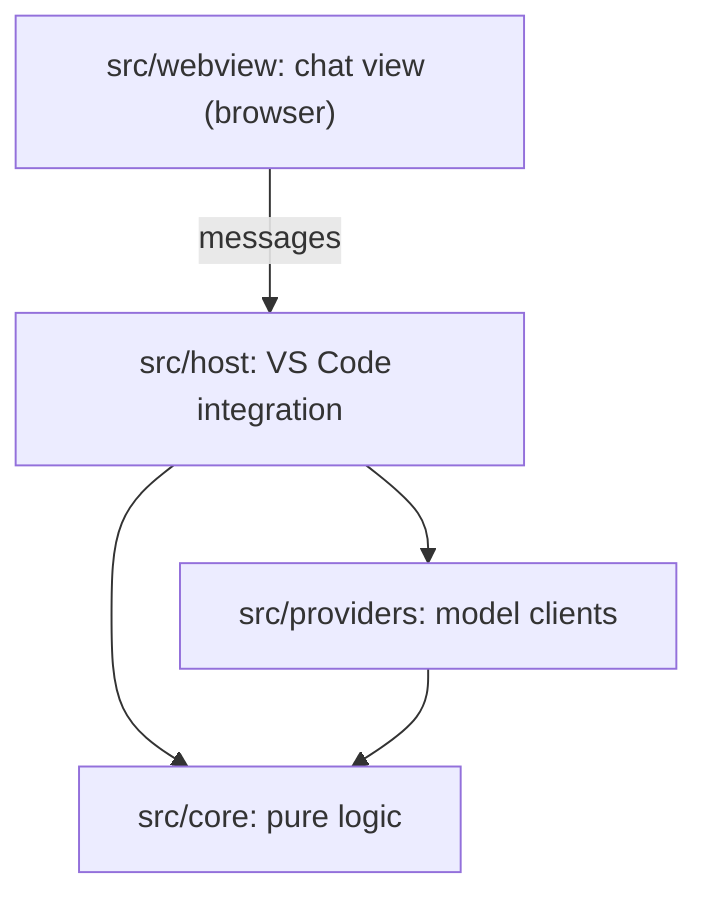

# Architecture

Phew has three layers.
Each layer depends only on the layers below it.

## `src/core`

Pure TypeScript without the `vscode` module, so unit tests run in Node.js.

| File | Purpose |
| --- | --- |
| `agent.ts` | The agent loop: model call, tool calls, step and budget limits, and the check loop that fixes until green. |
| `chat.ts` | Message types, argument parsing, and history trimming. |
| `tools.ts` | Tool definitions in JSON Schema and the tools of each mode. |
| `modes.ts` | Ask, Plan, and Code modes. |
| `prompts.ts` | The system prompt and the requests of the "Phew it!" workflows. |
| `diff.ts` | Line diff (Myers algorithm), hunks, and partial apply. |
| `checkpoints.ts` | Original file content per request and restore planning. |
| `commandPolicy.ts` | Dangerous command detection and auto-approve and deny lists. |
| `secrets.ts` | Sensitive file detection and secret redaction. |
| `cost.ts` | Token and cost tracking and budget limits. |
| `rules.ts` | Project rule files and their combination. |
| `mcp.ts` | Minimal Model Context Protocol client over newline-delimited JSON-RPC. |
| `sse.ts` | Server-Sent Events parser for streamed model responses. |
| `stats.ts` | Local statistics. |
| `paths.ts` | Workspace path containment. |

## `src/providers`

`openaiCompatible.ts` streams chat completions with tool calls from any OpenAI-compatible API.
`presets.ts` lists common providers and validates base URLs.

## `src/host`

| File | Purpose |
| --- | --- |
| `session.ts` | One conversation: builds the prompt, runs the agent, posts events to the view, and records statistics. |
| `toolHost.ts` | Executes tools inside the workspace with path, secret, trust, and command checks. |
| `changes.ts` | Shows changes as hunks, applies the selected hunks, records checkpoints, and serves the diff editor. |
| `approvals.ts` | Sends approval requests to the view and waits for the decision. |
| `commandRunner.ts` | Runs shell commands with a timeout, an output limit, and cancellation. |
| `mcpManager.ts` | Starts MCP servers and exposes their tools. |
| `phewIt.ts` | The "Phew it!" quick fix on problems. |
| `terminalWatcher.ts` | Remembers failed terminal commands through shell integration. |
| `chatView.ts` | The webview view provider and the transcript that rebuilds a hidden view. |
| `providerSetup.ts` | Provider, model, and API key setup. The key goes to SecretStorage. |
| `rulesLoader.ts`, `settings.ts`, `statsStore.ts`, `html.ts` | Rules, settings, statistics, and the webview document. |

## `src/webview`

The chat view runs in a sandboxed webview with a strict Content Security Policy and a script nonce.
`markdown.ts` builds DOM nodes from a safe Markdown subset and never parses HTML.
`src/shared/protocol.ts` defines the messages between the view and the host, and the host validates every message.

## Tests

- `test/*.test.ts`: unit tests with Vitest.
- `test/integration`: starts VS Code with the extension and a fake model server, fixes a file, runs the check, restores the checkpoint, and checks the "Phew it!" quick fix.
